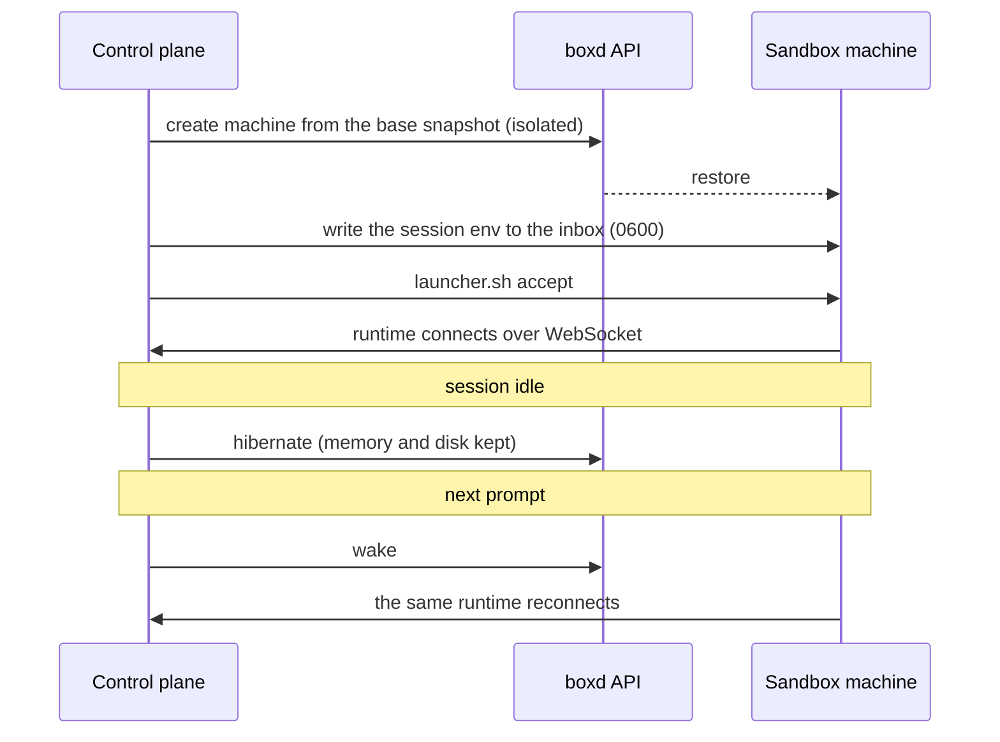

# boxd Sandbox Provider

Open-Inspect can run each session's sandbox as a [boxd](https://boxd.sh?ref=background-agents)
machine: a microVM with its own kernel, a full Ubuntu 24.04 userland, and a disk and memory that
survive a hibernate. Like any provider's sandbox, a boxd sandbox talks to your source-control host,
your model provider and any MCP servers you configure, and it has outbound internet access.

`SANDBOX_PROVIDER=boxd` works on both hosts. The control plane talks to boxd through the fetch-only
entry of the boxd SDK (`@boxd-sh/sdk/web`, gRPC-web over `fetch`), so the same code runs in the
Cloudflare Worker and on the Node host.

## How it works



- **Create.** Each session gets its own machine, created from the base snapshot
  `packages/boxd-infra` builds. Machines are created **isolated**: they join no network of the org,
  cannot reach another isolated machine, and carry no boxd credential. The control plane writes the
  session environment (sandbox auth token, repository secrets, MCP configuration) into the machine
  over the boxd file API, mode `0600`, and runs the baked launcher, which moves it to
  `/etc/openinspect` (mode `0600`, owned by root) and starts `openinspect-sandbox.service`. The
  service starts the runtime as `user`. Nothing secret rides a command line or the machine's
  metadata. See the security notes for what the agent itself can read.
- **Idle and resume.** An idle session's machine is **hibernated**: boxd writes its memory and disk
  to storage and releases the host. The next prompt wakes the same machine with every process where
  it was, so the runtime reconnects its bridge on the kept checkout. A machine that was stopped
  instead boots again, and the enabled service starts the runtime in restored mode, so `setup.sh`
  does not run again.
- **Archive and cancel.** Archiving a session saves and hibernates its machine like an idle stop, so
  the session can be unarchived and resumed. A session whose work is discarded or cancelled has its
  machine deleted.
- **Failed creates.** A machine's name is derived from its sandbox id and generation. When a create
  call fails without an answer (a timeout, a dropped connection) or boxd says the name is taken, the
  provider looks the name up and carries on with the machine it finds, so one generation never gets
  two machines. A machine that cannot be handed its session is deleted; if that delete fails too,
  the machine is reported to the control plane, which keeps it and retries the cleanup.
- **Idle on boxd's side.** Machines are created with auto-suspend off and with outbound traffic
  counting as activity, so a session whose runtime talks to the control plane is never put to sleep
  by boxd. boxd's own idle hibernate (the org's default, 4 hours unless changed) only reaches a
  machine nothing talks to any more, which keeps an abandoned machine from running on.

### Access URLs

code-server, the web terminal, the desktop (noVNC) and tunnel ports are named HTTPS proxies created
with the machine: `https://<name>.<machine>.boxd.sh` (`code`, `term`, `vnc`, `port-<n>`). The URLs
are public. code-server and the desktop are guarded by their own derived passwords, as on the other
providers. The first named proxy on a machine gets its certificate within about a minute, so a link
can show a TLS error right after the session starts.

### Not supported (yet)

- Prebuilt repository images. Every session clones and runs `setup.sh` on its first boot.
- Session snapshots and restore. A stopped sandbox always resumes in place.
- Per-session CPU and memory settings. A machine has the size of the base snapshot it is created
  from: 2 vCPU and 8 GiB, or what `BOXD_SANDBOX_VCPU` chose when the snapshot was built.
- A per-session lifetime. Idle sessions are hibernated by the control plane's inactivity timeouts.

## Model keys

The boxd provider passes no deployment-wide model key to sandboxes. Add the keys for the models you
plan to use (`ANTHROPIC_API_KEY` for Claude, for example) as **global secrets** in Settings ›
Secrets. See [Secrets Management](SECRETS.md).

## Setup

1. **API key.** Create a boxd API key for the org the sandboxes should run in (in the boxd console,
   or `boxd auth keys create open-inspect --org <org>` with the boxd CLI). The key is fenced to that
   org.

2. **Base snapshot.** Build it with the key:

   ```bash
   export BOXD_API_KEY=bxd_...
   export BOXD_REGION=fra                      # optional: fra or nyc
   npm run sandbox:images -- build --provider boxd --output /tmp/boxd-image.json
   cat /tmp/boxd-image.json   # {"reference":"openinspect-sandbox-<build hash>"}
   ```

   The build creates a temporary isolated machine from boxd's Ubuntu 24.04 image, installs the
   shared sandbox image bundle and the launcher, and saves the machine as the snapshot
   `openinspect-sandbox-<build hash>`. A second machine is then created from the snapshot and runs
   the image verification. Both machines are deleted, including on failure. A build whose snapshot
   already exists re-verifies it instead of building again. See
   [packages/boxd-infra](../packages/boxd-infra/README.md).

3. **Configure the control plane.** Set `SANDBOX_PROVIDER=boxd`, `BOXD_API_KEY` and
   `BOXD_BASE_SNAPSHOT` (the reference from step 2):
   - **Cloudflare:** add them to the deploy settings (`scripts/cloudflare-deploy/deploy.env.example`
     or the GitHub Environment): `BOXD_API_KEY` as a secret, the rest as variables, and set the
     Terraform `sandbox_provider` variable to `boxd` too.
   - **Node host:** add them to `.env` and restart the stack.

To rebuild the snapshot after `packages/sandbox-images`, `packages/sandbox-runtime` or
`packages/boxd-infra` change, run step 2 again and update `BOXD_BASE_SNAPSHOT`. Running and
hibernated sessions keep the machine they were created on.

## Configuration reference

| Variable              | Required | Meaning                                                                                |
| --------------------- | -------- | -------------------------------------------------------------------------------------- |
| `SANDBOX_PROVIDER`    | yes      | `boxd`                                                                                 |
| `BOXD_API_KEY`        | yes      | boxd API key; also the secret the code-server and VNC passwords are derived from       |
| `BOXD_BASE_SNAPSHOT`  | yes      | Snapshot built by `packages/boxd-infra`                                                |
| `BOXD_ORG`            | no       | Org machines are created in; defaults to the key's org                                 |
| `BOXD_REGION`         | no       | `fra` or `nyc`; defaults to the key's region. Use the region the snapshot was built in |
| `BOXD_MACHINE_PREFIX` | no       | Start of every machine name (default `openinspect`); distinct per deployment           |
| `BOXD_BASE_URL`       | no       | Another boxd API endpoint (Node host only)                                             |

Every machine carries the labels `openinspect/deployment` (`DEPLOYMENT_NAME`),
`openinspect/session-id` and `openinspect/sandbox-id`, so `boxd machine list --label` finds a
deployment's machines.

Sandboxes reach the control plane at `WORKER_URL`, from the public internet.

## Security notes

- Machines are isolated: no default network, no metadata endpoint, no in-machine boxd credential.
  The control plane's API key never enters a machine.
- The agent has `sudo` on its own machine, as on other full-VM providers. It can read the session
  environment it was started with, which is the same environment its runtime already holds.
- Proxy URLs are public; see [Access URLs](#access-urls).
